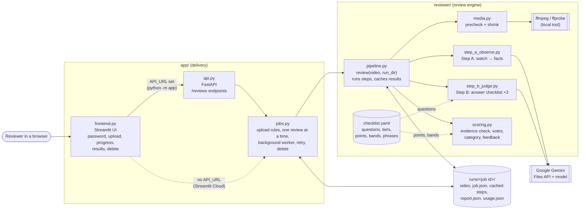

# Humaniti — class recording reviewer

Reviews a recorded online class for children (tutor + students, Zoom/Meet style) and returns:

- a **category**: Poor / Average / Good / Excellent
- a **quality-issue flag** with reasons (hard problems such as no 8x8 branding, face not visible, or the same setup
  problem repeating during the class)
- a **checklist**: each item pass / fail / unclear / n/a, with timestamps and a quote or description as evidence
- **feedback text** built from fixed phrases ("Good: … / Needs work: …"), so the same results always read the same

The only input is the video file.

## Setup

```bash
brew install ffmpeg          # ffmpeg + ffprobe are used locally before any API call
uv sync                      # Python 3.12 + dependencies
cp .env.example .env         # put your Gemini key in it, then load it:
set -a; source .env; set +a
```

## Usage

```bash
uv run python -m reviewer.cli path/to/class.mp4             # prints the feedback; full result in runs/<video name>/
uv run python -m reviewer.cli path/to/class.mp4 --force     # ignore all caches, redo every step
uv run python -m reviewer.cli path/to/class.mp4 --votes 1   # 1 Step B run instead of 3 (cheaper, no confidence)
uv run pytest                                               # offline tests, no API calls
```

Exit code 2 means the file can't be reviewed: not a video, no audio, under 5 minutes, mostly black or silent, or
not an online class recording.

## App (backend + frontend)

One command starts everything (needs the environment from Setup):

```bash
uv run python -m app        # open http://localhost:8501   (API docs: http://localhost:8000/docs)
```

`app/__main__.py` starts the backend, waits until it answers, then starts the frontend pointed at it. If either stops,
both stop; Ctrl+C stops both. Both listen on 127.0.0.1 only. Ports: `API_PORT` (8000) and `UI_PORT` (8501).
To run them separately (e.g. the backend alone for API use), point the frontend at the backend with `API_URL`:

```bash
uv run uvicorn app.api:app --port 8000
API_URL=http://localhost:8000 uv run streamlit run app/frontend.py
```

Without `API_URL` the frontend runs reviews by itself (the Streamlit Cloud mode). Don't run that alongside a backend
on the same `runs/` folder: the one-review-at-a-time rule only holds within one process.

- **Backend** (`app/api.py`, `app/jobs.py`): `POST /reviews` streams the upload into its own folder
  `runs/<job id>/`, queues the review and returns at once. `GET /reviews/{id}` gives the status and current step
  (precheck → watching the video → judging vote 1–3 → scoring) and the report when finished. `POST
  /reviews/{id}/retry` re-runs a failed job in the same folder, reusing finished steps. Only one review runs at a time:
  a new upload is refused (409) until the current one finishes. Jobs cut off by a restart are marked failed and
  can be retried. `DELETE /reviews/{id}` removes a finished review's video and results.
- **Frontend** (`app/frontend.py`): upload, live progress, then the category, issue points, quality issue and
  warnings, and "Good / Needs work" points, each with its reason, timestamps and the words spoken. A JSON download
  has the full report. Past reviews are in the sidebar, with retry for failed ones and a delete button (removes the
  video and its results). Uploads are blocked while a review is in progress. It uses the backend when `API_URL` is
  set and runs reviews itself otherwise; either way the Gemini key stays on the server, never in the browser.
- **Access:** set `APP_PASSWORD` and the frontend asks for it before anything else. Without it, anyone who can open
  the page can upload videos (fine on 127.0.0.1, not on a public deployment). The API itself has no login: keep it
  on a trusted network.

## Deploy on Streamlit Community Cloud

Community Cloud runs a single `streamlit run` process, so the frontend runs reviews itself there (no separate
backend; same job code, one review at a time).

1. Push the repo to GitHub (already done: `feby6/class-reviwer`, branch `dev`).
2. On [share.streamlit.io](https://share.streamlit.io): **Create app** → repository `feby6/class-reviwer`, branch
   `dev`, main file `app/frontend.py`.
3. Open **Advanced settings**: choose Python **3.12**, and paste your secrets into the **Secrets** box. The box
   takes **TOML**: one `NAME = "value"` per line, at the top level (no `[section]` header above them):
   ```toml
   GEMINI_API_KEY = "your-gemini-key"
   APP_PASSWORD = "choose-a-strong-password"
   ```
   Secrets can also be added or changed later: app menu **⋮ → Settings → Secrets** (the app restarts).
4. Deploy. Cloud installs Python packages from `uv.lock` and ffmpeg from `packages.txt`. The page should open on
   the password screen; if it doesn't, the secrets weren't picked up.

Never put keys in the repo (it is public): no `.env` and no `.streamlit/secrets.toml` in commits.

Things to know:
- **Set `APP_PASSWORD`.** The repo is public, so the app is public: without a password anyone with the link can
  upload videos and spend your Gemini credits.
- Uploads are limited to 1000 MB (`.streamlit/config.toml`): Streamlit holds uploads in memory and Cloud apps get
  about 2.7 GB at most. Shrinking a long video with ffmpeg on Cloud's small CPU share can take several minutes.
- The disk is not permanent: past reviews disappear when the app restarts or is redeployed. A review running at that
  moment is marked failed (it can be retried only if its folder survived).
- Apps sleep after 12 hours without visitors; opening the page wakes them.
- Videos are stored on Streamlit's servers (US) during review and sent to Google for Step A.

## Architecture



- **Two ways in, one engine.** Locally, `python -m app` runs the Streamlit frontend and the FastAPI backend; the
  frontend calls the API. On Streamlit Cloud (one process) the frontend calls `jobs.py` directly. Both paths use the
  same upload rules, worker and pipeline.
- **The engine doesn't know about the app.** `reviewer/` takes a video and a folder and returns a report; it can be
  used from the command line (`reviewer/cli.py`) or any other front end.
- **AI only where it is needed.** Gemini watches the video (Step A) and answers narrow checklist questions (Step B).
  Everything that decides the result (evidence check, votes, points, category, feedback text) is plain code, so the
  same answers always give the same report.
- **Everything about a review lives in its folder.** Each upload gets `runs/<job id>/`; every paid step is cached
  there, so retries and re-scoring don't pay twice.

## How it works

```
upload ──► 1. precheck ──► 2. shrink ──► 3. Step A: observe ──► 4. Step B: judge ×3 ──► 5. scoring ──► report.json
           free, local      free, local    Gemini sees video       Gemini, text only        code only
           ffprobe/ffmpeg   480p, 2 fps    + audio → facts         facts → item answers     category + feedback
           unreviewable?                   (~100k tokens)          (~15k tokens)
           stop here
```

1. **precheck** (`media.py`): reads duration and streams, scans for black screen and silence. A file that can't be
   reviewed stops here and costs nothing.
2. **shrink** (`media.py`): re-encodes to 480p, 2 fps, mono audio so the upload is small.
3. **Step A — observe** (`step_a_observe.py`): uploads the small video to Gemini, which watches 1 frame every 20 s
   plus the full audio and returns timestamped facts only (`schemas.Observations`): 8x8 branding, camera and face,
   lighting, setup warnings, opening, new joiners, questions to children, praise, closing, homework. The upload is
   deleted from Google straight after. Gemini first decides whether the video is an online class at all; if not
   (movie, vlog, lecture without students…), the result is "unreviewable: not an online class recording" and
   Step B is skipped. Step A's tokens are still spent, because the video has to be watched to know.
4. **Step B — judge** (`step_b_judge.py`): Gemini answers each question in `checklist.yaml` from the facts only:
   pass / fail / unclear / n/a, with timestamps, a quote (speech) or description (visuals) and a one-line reason.
   It runs 3 times; it never grades the class or writes feedback.
5. **scoring** (`scoring.py`), code only:
   - evidence check: a pass on a speech item needs a timestamp + the quoted words; any other answer needs a timestamp
     + a description or quote (something that was never said, like missing homework, can't be quoted, so the moment
     it should have happened is described). An answer without its evidence becomes unclear; timestamps past the end
     of the video are dropped
   - majority vote per item across the 3 runs; agreement between runs = confidence
   - any **hard** item fails → Poor + quality-issue flag
   - otherwise issue points: core fail 2, minor fail 1, unclear 0.5 → bands (0–1 Excellent, 2–3 Good, 4–5 Average,
     6+ Poor); 3+ unclear items → low confidence; points exactly on a band edge → borderline
   - feedback text from each item's fixed "good" / "improve" phrase plus its evidence

`pipeline.py` runs these steps in order and caches each result; `cli.py` is a thin command-line wrapper.

## Code map

| File | What it does |
|---|---|
| `app/__main__.py` | one-command launcher for backend + frontend |
| `app/api.py` | FastAPI backend: upload, status, retry, delete |
| `app/jobs.py` | upload rules, job folders, status files, background worker |
| `app/frontend.py` | Streamlit frontend (uses the backend, or runs reviews itself when deployed alone) |
| `reviewer/pipeline.py` | `review(video, run_dir)`: runs the steps in order, caches every result |
| `reviewer/cli.py` | command line entry point |
| `reviewer/media.py` | precheck and shrink (ffprobe / ffmpeg) |
| `reviewer/step_a_observe.py` | Step A prompt, upload, Gemini call, upload cleanup |
| `reviewer/step_b_judge.py` | Step B prompt and Gemini call |
| `reviewer/scoring.py` | grounding, majority vote, category rules, feedback template |
| `reviewer/gemini_client.py` | Gemini client: model, seed, timeout, retries |
| `reviewer/schemas.py` | data shapes for Step A and Step B (also Gemini's output schemas) |
| `reviewer/checklist.yaml` | checklist questions, tiers, points, bands, feedback phrases |
| `evaluation/evaluate.py` | compare categories with human labels |
| `evaluation/check_alignment.py` | check Step B against Step A (free, offline) |
| `tests/` | offline tests, one file per module |

## Changing the checklist

Everything about judging lives in `reviewer/checklist.yaml`:

- `check` is the question Step B answers. Changing it re-runs Step B only (~15k tokens per video).
  **Step A must still collect the facts the question needs**: if you add a question about something new, add it to
  the "What to look for" list in `step_a_observe.py` and a field in `schemas.Observations` (re-runs Step A).
- `tier`, `points`, `bands`, `good`, `improve` only affect scoring and wording: changing them costs nothing.

## Run folder and caching

Each review writes to its own run folder (the CLI uses `runs/<video name>/`; an app must use one folder per upload so
two files with the same name don't overwrite each other):

| File | Contents | Reused while… |
|---|---|---|
| `precheck.json` | duration, streams, black/silence, problems | the source file's size and modified time are unchanged |
| `video_small.mp4` | the shrunk upload | same as above |
| `step_a_observations.json` + `.key` | Step A facts | Step A prompt, schema, model, fps and resolution are unchanged |
| `step_b_cache/<key>.json` | one Step B answer per vote | model, seed, prompt, answer schema and temperature are unchanged |
| `report.json` | the final result | always rewritten |
| `usage.json` | tokens per call, model version, or "cached" | always rewritten |

## Evaluation

```bash
uv run python -m evaluation.evaluate category_test/               # one subfolder per human label
uv run python -m evaluation.evaluate category_test/ --stability   # run each video twice, no cache, compare
uv run python -m evaluation.check_alignment                       # free: Step B vs Step A consistency
```

- Label folders `weak`, `quality_issue`, `known_quality_issues` map to Poor (the quality ones also expect the flag).
- `evaluate` prints per-video points, predicted category and failed items, a confusion matrix, and exact /
  within-one / quality-flag counts. Results go to `runs/evaluation_results.json`.
- `check_alignment` checks that every quote and timestamp Step B cites exists in Step A's facts, and that statuses
  match plain facts (branding seen, homework given, media played, praise found, new joiners invited, …).
- The labelled videos are not part of the repo: point `evaluate` at any folder with one subfolder per label.

## Configuration

| Variable | Default | Meaning |
|---|---|---|
| `GEMINI_API_KEY` | (required) | Gemini API key |
| `GEMINI_MODEL` | `gemini-3.8-flash` | model id for both steps (pinned; the served version is logged in `usage.json`) |
| `APP_PASSWORD` | (none) | if set, the frontend asks for it before anything else (set it on Cloud) |
| `RUNS_DIR` | `runs` | where the app keeps one folder per upload |
| `MAX_UPLOAD_MB` | `1000` | largest accepted upload (also set `maxUploadSize` in `.streamlit/config.toml`) |
| `API_PORT` / `UI_PORT` | `8000` / `8501` | ports used by `python -m app` |
| `API_URL` | (none) | where the frontend finds the backend; set automatically by `python -m app`. Unset: the frontend runs reviews itself |

Fixed in code: temperature 0, seed 7 (votes use 7, 8, 9), 10-minute request timeout, 1 frame per 20 s, low media
resolution.

## Known limits

- Only what Step A can observe is judged: background flicker and voice energy are out of scope.
- Calibrated on 10 labelled videos (2 per label), so accuracy on new classes is uncertain.
- A fixed seed doesn't guarantee identical answers; borderline items can change between runs.
- Recordings over ~90 minutes are untested.
- Children's video is sent to Google for Step A (deleted right after); a consent and retention policy is still needed.
